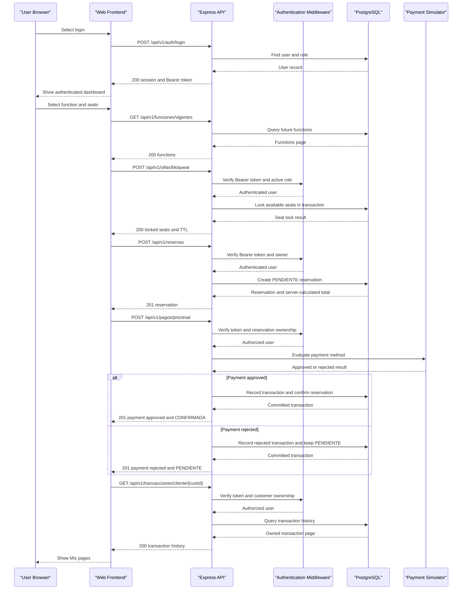

# API & Service Communication Contracts

Cinema Monarca exposes a versioned JSON REST API with a legacy path alias. Browser requests, business operations, and persistence calls are synchronous; payment processing is simulated in-process.

## Service Catalog

| Service | Port | Category | Purpose |
|---|---:|---|---|
| Cinema Monarca web/API (`backend`) | `PORT` (8080 locally; assigned by Render in production) | API Layer | Express REST API and production static frontend, deployed together as one web service. |
| Frontend (`frontend`) | 5173 in Vite development | API Layer / client | Browser application built by Vite; production assets are served by the backend. |
| PostgreSQL | 5432 locally; managed endpoint in production | Infrastructure | Persistent users, cinema catalog, functions, seats, reservations, and transactions. |

Render deploys one Node web service from `render.yaml`; PostgreSQL is provisioned separately. The API uses Express 5, `pg`, JWT, and `bcryptjs`; the frontend uses Vite and Navigo.

## API Endpoints Inventory

The complete route-by-route reference, including access roles, request/response descriptions, common errors, and a working checkout walkthrough, is maintained in [backend/docs/API.md](../../../../../backend/docs/API.md). The API currently exposes more than 30 routes; this inventory groups them by router.

| Service / router | Method and paths | Request type | Response type |
|---|---|---|---|
| Health | `GET /health` | None | Health JSON; HTTP 503 if PostgreSQL is unavailable. |
| Authentication | `POST /auth/register`, `POST /auth/login`, `GET /auth/me`, `PATCH /auth/password` | JSON credentials/profile; password update body; optional Bearer token as documented per route | JSON session/token, profile, or confirmation message. |
| Users | `GET /usuarios`, `GET /usuarios/{id}`, `PATCH /usuarios/{id}/rol`, `PATCH /usuarios/{id}/perfil`, `DELETE /usuarios/{id}` | Path ID, role/profile JSON, pagination | User JSON/page or operation result; no password hash is returned. |
| Managers | `GET /gestores`, `POST /gestores`, `DELETE /gestores/{id}` | Assignment JSON or path ID | Assignment list, new assignment, or confirmation. |
| Cinemas | `GET /cines`, `GET /cines/{id}`, `POST /cines`, `PUT /cines/{id}`, `DELETE /cines/{id}` | Cinema JSON, path ID, pagination | Cinema JSON/page or `204` on deletion. |
| Branches | `GET /sucursales`, `/sucursales/cine/{cineId}`, `/sucursales/{id}`, `POST /sucursales`, `PUT /sucursales/{id}`, `DELETE /sucursales/{id}` | Branch/cinema path IDs and JSON | Branch JSON/list or `204` on deletion. |
| Rooms | `GET /salas`, `/salas/tipo/{tipo}`, `/salas/{id}`, `/salas/{id}/asientos`, `POST /salas`, `PUT /salas/{id}`, `DELETE /salas/{id}` | Type/path IDs or room JSON | Room JSON/list with generated seat layout or `204`. |
| Movies | `GET /peliculas`, `/peliculas/{id}`, `/peliculas/{id}/poster`, `POST /peliculas`, `/peliculas/{id}/poster`, `DELETE /peliculas/{id}/poster`, `PUT /peliculas/{id}`, `DELETE /peliculas/{id}` | Optional filters/pagination, movie JSON, poster data URL, path ID | Movie JSON/page, poster JSON, or `204`. |
| Functions | `GET /funciones`, `/vigentes`, `/pelicula/{movieId}`, `/sala/{salaId}`, `/rango`, `/{id}`, `POST /funciones`, `/programar`, `PUT /funciones/{id}`, `DELETE /funciones/{id}` | Filters/date range/pagination, function JSON, or path ID | Function JSON/page, bulk creation result, or `204`. |
| Seats | `GET /sillas/funcion/{funcionId}`, `POST /sillas/bloquear`, `DELETE /sillas/liberar` | Function ID or JSON containing function ID and seat codes | Seat map, lock/TTL details, or release confirmation. |
| Customers | `GET /clientes`, `/clientes/{id}`, `POST /clientes`, `PUT /clientes/{id}`, `DELETE /clientes/{id}` | Customer JSON, ID, filters/pagination | Customer JSON/page or `204`. |
| Reservations | `GET /reservas`, `/reservas/{id}`, `POST /reservas`, `PATCH /reservas/{id}/cancelar`, `DELETE /reservas/{id}` | Reservation JSON, ID, pagination | Reservation JSON/page, cancellation/refund result, or `204`. |
| Payments | `POST /pagos/procesar` | JSON reservation ID, payment type, optional card number | JSON transaction result; reservation status is confirmed only for approved payments. |
| Transactions | `GET /transacciones`, `/transacciones/cliente/{custId}` | Customer ID and pagination | Transaction page; card number is not returned, only last four digits. |
| Occupancy | `GET /ocupacion` | Authenticated manager context; no caller-selected branch | Branch-scoped occupancy JSON. |
| Sales reports | `GET /reportes/ventas`, `/reportes/ventas/csv` | Required date range query | Sales JSON or downloadable CSV. |

Canonical prefix: `/api/v1`; `/api` is maintained as an equivalent compatibility alias. There is no separate API version header.

## Management & Observability Endpoints

| Service | Endpoint | Custom Metrics |
|---|---|---|
| Cinema Monarca API | `GET /api/v1/health` and alias `/api/health` | No custom metrics exporter found. Checks PostgreSQL connectivity and returns `200 { status: "ok", db: "up" }` or `503` with `db: "down"`. |

No Actuator, Prometheus endpoint, Swagger UI, or OpenAPI specification is configured in the backend.

## DTOs & Contracts

The JavaScript implementation maps database rows into JSON objects rather than declaring a separate class or record per request/response. Principal contract shapes are `sesion` (register/login response), user profile, cinema/branch/room/movie/function, customer, reservation, payment/transaction, occupancy, and sales report. The API reference documents each route's accepted JSON and response shape.

There is no gateway aggregation DTO: the Express API is the only application API service. Some response objects compose related data in a single database query, such as a function with its movie and room, or a reservation with movie and room names. JSON is serialized by Express. No OpenAPI, GraphQL, or protobuf schema was found.

## Communication Patterns

- The browser calls the same-origin REST API in production. In development, Vite proxies `/api` to the local Express server.
- Controllers/services call PostgreSQL synchronously through `pg`; reservation creation, seat updates, payment recording, and reservation confirmation use database transactions where required.
- Payment is a deterministic in-process simulator. It does not call a bank, payment gateway, or external provider.
- No message broker, asynchronous inter-service communication, service discovery, API gateway, circuit breaker, or retry policy was found.
- Database operations rely on PostgreSQL connection configuration; the application does not implement a request retry/fallback policy. The health endpoint reports database unavailability as HTTP 503.
- Authentication uses Bearer JWT. Authorization is enforced by database-backed roles (`USER`, `GESTOR`, `ADMIN`) and ownership checks. A manager's branch is resolved from the authenticated account, rather than a caller-supplied branch ID.
- Production is configured to use HTTPS at the Render web-service boundary and `DB_SSL=true` for a managed PostgreSQL connection. Local development may use HTTP and `DB_SSL=false`. CORS allows the same origin and only explicitly configured external origins.
- For startup, Render runs `npm run db:migrate` before starting the Node server. Full environment variable ownership and deployment details are in [backend/docs/CONFIGURACION.md](../../../../../backend/docs/CONFIGURACION.md).

## Service Technology Matrix

| Service | Web | Data Access | Discovery | Gateway | Health | Cache | Metrics |
|---|---|---|---|---|---|---|---|
| Cinema Monarca web/API | Express 5 | PostgreSQL via `pg` | None | Single application API; no aggregation gateway | `/api/health` | No application cache identified | No custom exporter identified |
| Frontend | Vite SPA | REST client | N/A | No | N/A | Browser defaults | No |
| PostgreSQL | PostgreSQL | Native SQL | Managed endpoint / local connection | No | Probed by API health route | PostgreSQL internal buffers | Provider-managed, not exported by this app |

## Service Communication Sequence

<!-- mermaid-checked: every participant uses `participant Id as "Label"`, no \n in aliases/messages/notes, every alt/opt/loop closed by end, no `:` inside any alias -->

